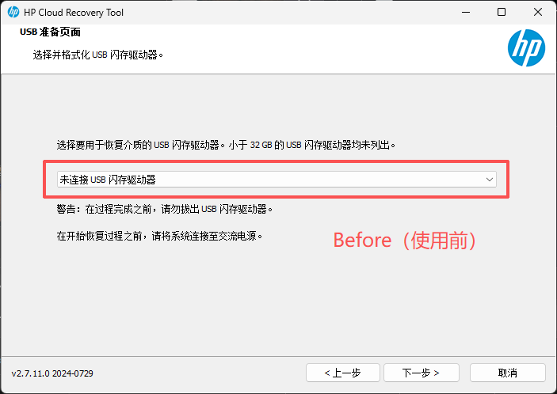
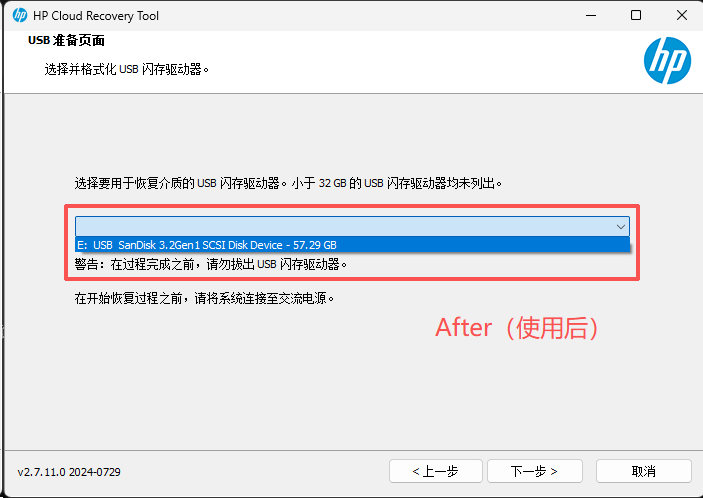

# HP Cloud Recovery Tool - UASP / SCSI U 盘补丁

[简体中文](README.md) | [English](README.en.md)

这是一个只修改**运行中进程内存**的小补丁，用于让 **HP Cloud Recovery Tool 2.7.11.0 (x64)** 识别因使用 **UASP**（USB Attached SCSI Protocol）而被 Windows 报告为 **SCSI** 接口的 USB 闪存盘。

不会修改 `C:\Program Files\WindowsApps` 下的任何文件。补丁只存在于当前进程内存中，关闭程序即失效。

> 本项目与 HP Inc. 无关。使用风险自负。恢复过程会清空所选 U 盘。

---

## 问题原因

HP Cloud Recovery Tool 只接受 `Win32_DiskDrive.InterfaceType` 等于 `USB` 的磁盘：

```text
GetRemovableUsbDiskList
  -> 过滤 InterfaceType == "usb"
  -> 过滤媒体类型
  -> 过滤容量 >= 27 GiB
```

很多 USB 3.x 闪存盘使用 UASP，在 WMI 中报告为：

```text
InterfaceType : SCSI
MediaType     : Removable Media
Capabilities  : 3,4,7
```

U 盘在 Windows 和资源管理器中完全正常，但工具下拉框显示 **“未连接 USB 闪存驱动器”**。日志可以确认磁盘被扫描到了，随后又被过滤掉：

```text
ScanDisks - disk count 3
GetRemovableUsbDiskList - 0
```

这不是容量问题，也不是“USB 3.2 Gen 1 太新”，而是 `InterfaceType` 判断的问题。

## 修复前后

截图中的界面语言为中文；测试 U 盘为 SanDisk 3.2Gen1 64GB。

| 修复前 | 修复后 |
|---|---|
|  |  |

## 补丁做了什么

补丁把运行中进程的第一个过滤条件从：

```asm
; 原始代码
mov  rcx, [rbx+30h]        ; Disk::interfaceType
lea  rdx, [L"usb"]
call _wcsicmp
test eax, eax
jz   keep
```

改成：

```asm
; 补丁后
mov  rcx, [rbx+70h]        ; Disk::mediaType
lea  rdx, [L"Removable"]
call wcsstr
test eax, eax
jnz  keep
```

结果：

| 磁盘 | MediaType | 是否列出 |
|---|---|---|
| USB 闪存盘（UASP / SCSI） | `Removable Media` | **是** |
| USB 闪存盘（BOT / USB） | `Removable Media` | **是** |
| 内置 NVMe / SATA SSD | `Fixed hard disk media` | 否 |
| USB 硬盘盒 | `External hard disk media` | 否 |

工具的其余逻辑完全没有改动：选盘、`diskpart`、建分区、解压镜像、校验仍然走原代码。

## 支持的版本

| 项目 | 值 |
|---|---|
| 程序 | HP Cloud Recovery Tool |
| 版本 | `2.7.11.0` |
| 架构 | x64 |
| `CloudRecovery.exe` SHA-256 | `8870CC8AE9ECBAE9A2DE5D6591A12D92F932E6D8B4E0D7FAC28AD71847713E5E` |

脚本会拒绝给其他版本打补丁。HP 以后可能修改过滤逻辑或偏移；不要绕过这个检查。

## 快速开始

1. 插上 U 盘。
2. 双击 **`Start-HPCloudRecovery-Patched.cmd`**。
3. 在 UAC 提示中允许管理员权限。
4. 脚本会启动 HP Cloud Recovery Tool 并自动打补丁。
5. 正常使用工具，U 盘应该会出现在下拉框中。

首次启动仍会显示 EULA 并要求输入 HP 产品 ID，这部分没有改动。

### 终端语言

终端消息支持中文和英文。默认 `-Language zh`（中文）。可用 `-Language auto` 跟随 Windows 区域设置（中文系统显示中文，否则英文），或用 `-Language en` 强制英文；`.cmd` 启动器会透传参数。

```powershell
.\Start-HPCloudRecovery-Patched.cmd -Language en
powershell -NoProfile -ExecutionPolicy Bypass -File .\Start-HPCloudRecovery-Patched.ps1 -Language auto
```

### 只校验

```powershell
powershell -NoProfile -ExecutionPolicy Bypass -File .\Start-HPCloudRecovery-Patched.ps1 -VerifyOnly
```

退出码 `0` 表示当前进程已打补丁（或已安装受支持的版本但程序未运行）。

### 给已经运行的程序打补丁

```powershell
powershell -NoProfile -ExecutionPolicy Bypass -File .\Start-HPCloudRecovery-Patched.ps1 -NoLaunch
```

## 环境要求

- Windows 10/11 x64
- 64 位 PowerShell 5.1 或更高版本
- 管理员权限（工具本身格式化磁盘也需要管理员权限）
- 已从 Microsoft Store 安装 HP Cloud Recovery Tool 2.7.11.0

## 安全性与限制

- **只改内存。** 不修改安装文件、不碰签名、不安装驱动。
- **锁定版本。** 打补丁前会校验 `CloudRecovery.exe` 的 SHA-256。
- **内置磁盘不会出现。** 新过滤条件只接受 `Removable Media`；内置 NVMe/SATA 报告的是 `Fixed hard disk media`。
- **仍然要确认磁盘。** 选中的 U 盘会被清空并重新分区。点“下一步”前请确认盘符、型号和容量。
- **不解决下载/catalog 问题。** 如果工具提示“未在目录中找到下载的文件……”，那是另一个 catalog/缓存问题。
- **程序更新后。** 如果 Store 更新了程序，脚本会拒绝打补丁，直到偏移和哈希更新。

## 不打补丁的替代方案

如果不想改程序，可以禁用 UASP，让 U 盘以 USB 方式枚举：

```reg
HKLM\SYSTEM\CurrentControlSet\Services\UASPStor\Start = 4
```

重启后创建恢复介质，完成后再改回 `3` 并重启。使用 USB 2.0 端口或 USB 2.0 Hub 也会强制走 BOT 协议。

代价：禁用 UASP 会影响所有 USB 3.x 存储设备，吞吐量会下降。

## 技术分析

WMI 证据、反编译后的过滤函数和具体补丁字节见 [docs/TECHNICAL.zh-CN.md](docs/TECHNICAL.zh-CN.md)。

## 文件说明

```text
Start-HPCloudRecovery-Patched.cmd   自动提升权限的启动器
Start-HPCloudRecovery-Patched.ps1   打补丁 / 校验脚本
README.md                           中文说明（默认）
README.en.md                        英文说明
docs/TECHNICAL.md                   英文技术分析
docs/TECHNICAL.zh-CN.md             中文技术分析
docs/images/before.png              修复前截图
docs/images/after.png               修复后截图
CHANGELOG.md                        中文版本记录
CHANGELOG.en.md                     英文版本记录
.gitignore                          本地产物 / 截图
LICENSE                             MIT
```

## 法律声明

本项目不包含 HP 的代码或二进制文件，与 HP Inc. 无关联。它只是针对磁盘枚举的互操作性修复。你需要遵守适用于你所持有的 HP Cloud Recovery Tool 副本的 HP 软件许可协议。不要用它绕过授权，或制作你无权使用的恢复介质。

## 许可证

MIT，见 [LICENSE](LICENSE)。

HP、HP Cloud Recovery Tool、OMEN 是 HP Inc. 的商标。本项目是独立的互操作性修复，与 HP 无关联，也未获得 HP 背书。
